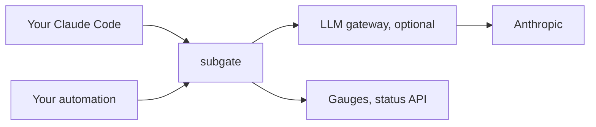

# subgate

> A self-hosted proxy that gives each of your programs a paced weekly share of your own AI subscription.

> [!IMPORTANT]
> subgate is independent software, not affiliated with or endorsed by Anthropic. Run it yourself, for your own subscription, on your own login, for your own programs. Never host it for other people or share a subscription through it. Whether your use complies with Anthropic's Consumer Terms and Usage Policy is yours to check; see [docs/legal.md](docs/legal.md).

**Status: design.** No code yet. The plan is in [docs/](docs/): what it does and why ([features](docs/features.md)), how ([architecture](docs/architecture.md) and its [ADRs](docs/adr/)), the first version's [spec](docs/specs/v0.1.md), and the [roadmap](docs/roadmap.md).

## Why

One Claude Max plan has one weekly allowance, shared by you and every program you run on your login: coding agents, background jobs, an assistant. Nothing stops one of them from spending the week by Wednesday, and none of them knows how much is left.

subgate sits in front of the subscription (directly, or in front of an LLM gateway), reads the plan's own usage meter from each reply, and works out each program's share. Each program gets a slice of the week, paced over the days: unused allowance carries forward, and going past the line is your decision. From v0.2, a program over its line is held with a clear 429, moved to your API key under a daily dollar cap, or moved to a cheaper model. Your own interactive sessions are measured and never gated, and they keep working when subgate is down.

## What it never does

It never stores or logs your token, never changes your client's identity headers, never rotates accounts, and never helps get past a limit. It serves one owner.

## Licence

MIT. See [LICENSE](LICENSE).
