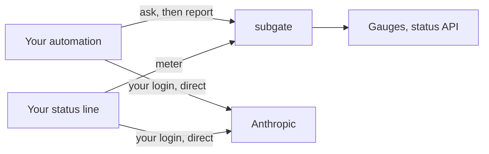

# subgate

> A self-hosted ledger that gives each of your programs a paced weekly share of your own AI subscription.

> [!IMPORTANT]
> subgate is independent software, not affiliated with or endorsed by Anthropic. Run it yourself, for your own subscription, on your own login, for your own programs. Never host it for other people or share a subscription through it. Whether your use complies with Anthropic's Consumer Terms and Usage Policy is yours to check; see [docs/legal.md](docs/legal.md).

**Status: design.** No code yet. The plan is in [docs/](docs/): what it does and why ([features](docs/features.md)), how ([architecture](docs/architecture.md) and its [ADRs](docs/adr/)), the first version's [spec](docs/specs/v0.1.md), and the [roadmap](docs/roadmap.md).

## Why

One Claude Max plan has one weekly allowance, shared by you and every program you run on your login: coding agents, background jobs, an assistant. Nothing stops one of them from spending the week by Wednesday, and none of them knows how much is left.

subgate sits beside the subscription, never in front of it. Before a job, your program asks it "may I start, and how much is left?"; then it runs Claude Code or the Agent SDK on your login as usual, straight to Anthropic, and reports what it used. subgate reads the plan's own meter from what those clients already receive, works out each program's share, and paces it over the week: unused allowance carries forward, and going past the line is your decision. From v0.2 it answers a program that's over with "hold", "use your API key" (under a daily dollar cap) or "use a cheaper model". Your own interactive sessions are measured and never asked.

## What it never does

It never sits in the request path, never holds a token or key, never changes how your client identifies itself, never rotates accounts, and never helps get past a limit. It serves one owner.

## Licence

MIT. See [LICENSE](LICENSE).
