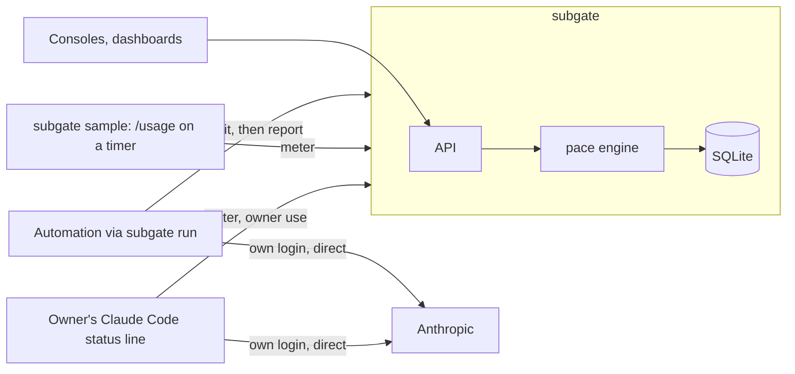

# Architecture

subgate is a ledger beside an AI subscription, not a proxy in front of it. Each of the owner's programs asks subgate before a job ("may I start, how much is left?"), runs the unmodified Claude Code or Agent SDK on the owner's login, calls Anthropic directly, and reports what it used. subgate combines those reports with the plan's own meter, works out each program's share of the week, compares it with a pace line, and, from v0.2, answers "hold", "use your API key" or "use a cheaper model" when a program is over. No request and no credential ever passes through it (ADR 0003).

## A job's life

1. `subgate run --consumer nightly-review -- claude -p … --output-format stream-json --verbose` asks `POST /v1/admit`.
2. subgate answers from the consumer's state. Every `allow` opens a lease that reserves the job's estimate. Observe mode (v0.1): always `allow`, with `would` saying what enforce mode would answer. Enforce mode (v0.2): `allow`; `hold` with `retry_after_s`; `api` (run on your own API credential); or `cheap` (run this model on your API credential). `subgate run` passes the decision to the command as `SUBGATE_DECISION` and `SUBGATE_MODEL`; the command's own configuration switches credential or model. subgate holds none.
3. The command runs and talks to Anthropic directly. `subgate run` reads its output: each `rate_limit_event` (the plan's meter) and the final result's `modelUsage` (cost per model at list price).
4. `subgate run` posts the meter to `POST /v1/signal` and the use to `POST /v1/usage`, which closes the lease.

Between jobs, `subgate sample` keeps the meter fresh by running `/usage` on the owner's login every 30 minutes, and the owner's status line posts the meter and the owner's own session cost (ADR 0012).

## The engine

- **Windows.** The plan reports a 5-hour and a 7-day window, each with a utilization (resolution: one point) and a reset time. The week is keyed by the 7-day `resets_at`.
- **Pace line.** allowance_c(t) = share_c × elapsed ÷ 7 days, where elapsed = 7 days − (reset − now). Counters are cumulative, so unused allowance carries forward.
- **Attribution.** Apportion meter rises by reported weighted use while all use is reported; calibrated weighted use × k otherwise (ADR 0005).
- **Leases.** An admitted job reserves its estimate until it reports or the lease expires (ADR 0007).
- **States.** `OK`; `OVER_PACE` when used_c plus open reservations exceeds allowance_c(t), or when the account is above the total pace line; `LIMITED` after any reporter saw `status: rejected`, until the reported reset; `STALE` when the meter is older than the limit (ADR 0008).
- **Owner.** Measured, never gated: `admit` always allows `owner`, and the owner's interactive sessions never call `admit`.

## Decisions

| ADR | Decision | Status |
|---|---|---|
| [0001](adr/0001-name-and-license.md) | Name subgate, MIT | accepted |
| [0002](adr/0002-language-and-runtime.md) | .NET 10 Native AOT | accepted |
| [0003](adr/0003-where-it-sits.md) | Out of the request path: a ledger | accepted |
| [0004](adr/0004-engine-library.md) | The engine is an I/O-free library, `Switchknife.Pace` | accepted |
| [0005](adr/0005-attribution.md) | Apportion by reported use, calibrate when some is unreported; target ≤ 5 points p95 | proposed |
| [0006](adr/0006-consumer-identity.md) | A bearer token per consumer, stored as a hash | proposed |
| [0007](adr/0007-control-api.md) | Admit, report, signal, leases; consoles are clients | proposed |
| [0008](adr/0008-failure-modes.md) | The owner never depends on subgate; automation holds when it's down | proposed |
| [0009](adr/0009-state-and-policy.md) | SQLite state; YAML defaults overlaid by API overrides | proposed |
| [0010](adr/0010-transports.md) | Ledger first; the proxy is off the roadmap | accepted |
| [0011](adr/0011-ci-for-a-public-repo.md) | Own CI on GitHub-hosted runners | accepted |
| [0012](adr/0012-signal-sources.md) | Signal from the clients' own output, a `/usage` sampler and the status line | proposed |
| [0013](adr/0013-plan-and-gateway-adapter.md) | The plan is published; no gateway writer is built (adapter deferred) | accepted |

## Facts this design rests on

- Anthropic documents the plan's meter reaching clients without a proxy: `rate_limit_event` in Agent SDK and stream-json output, the `/usage` report, and `rate_limits` in the status line input; and per-run `modelUsage` and `total_cost_usd` (ADR 0012, with links).
- The meter is account-wide with a resolution of one point of the week; one 280k-token run didn't move it (spike, 2026-10-28, from real response headers).
- A simulated week puts the calibrated estimate at 3.1–4.5 points p95 for the worst consumer at any level of unreported use (ADR 0005).
- A 429 reaches Claude Code callers as `api_error_status: 429` and `error: rate_limit`, so `hold` maps onto handling callers already have (spike; hooks docs).

## Prior art

| Tool | Gives | Missing |
|---|---|---|
| ccflare | load-balancing over several provider accounts, a dashboard | per-client shares; a proxy built around rotating accounts it owns |
| anthropic-proxy (a personal Go project) | reads the 5h/7d meter, per-window counters persisted | per-consumer shares (UNKNOWN); a proxy that stores the OAuth credential |
| LiteLLM subscription pass-through | forwards the client's token, logs per virtual key | reads no meter; budgets in API dollars only; a proxy |

All three sit in the request path. Borrowed: counters persisted per window.

## Providers after Anthropic

The provider component (ADR 0004) is what a second plan needs: where its meter appears for a client, and how its runs report usage. For OpenAI and Codex plans that is UNKNOWN until that milestone's spike.
