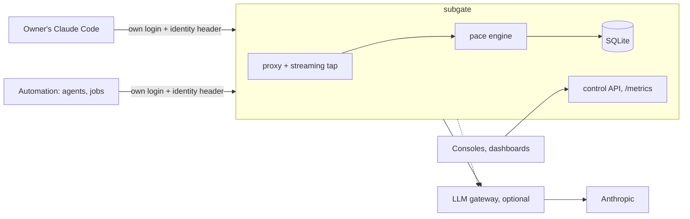

# Architecture

subgate is a small streaming proxy in front of an AI subscription. It reads the plan's own usage meter from the replies, attributes the usage to the programs that made it, compares each program's share with a pace line, and, from v0.2, acts when a program is over: hold it, move it to an API key, or move it to a cheaper model.

## Request path

1. A client (Claude Code, the Agent SDK) sends its own OAuth token and an identity header. subgate maps the header's hash to a consumer (ADR 0006).
2. In observe mode (v0.1), the request is forwarded unchanged. In enforce mode (v0.2), the engine's state for the consumer picks: forward, `hold` (a 429 shaped like Anthropic's, with `retry-after` and `x-subgate`), `api` (the credential is swapped for the consumer's API key under a daily dollar cap) or `cheap` (the same, with the model rewritten).
3. The reply streams back unbuffered. A tap copies chunks to a bounded channel (ADR 0008); the provider adapter parses the limit headers and the usage in `message_start` and `message_delta`.
4. The engine adds model-weighted tokens to the consumer's counter for the current week and updates the account snapshot.

## The engine

- **Windows.** The plan reports a 5-hour and a 7-day window; each has a utilization (0–1, resolution 0.01) and a reset time. The week is keyed by `7d-reset`.
- **Pace line.** allowance_c(t) = share_c × elapsed ÷ 7 days, where elapsed = 7 days − (reset − now). Counters are cumulative, so unused allowance carries forward.
- **Attribution.** Apportion by weighted tokens while every use is tracked; calibrated tokens × k otherwise (ADR 0005).
- **States.** `OK`; `OVER_PACE` when used_c > allowance_c(t), or when the account is above the total pace line; `LIMITED` on a 429 or `status: rejected` until the reported reset; `STALE` when the last snapshot is older than the limit (ADR 0008).
- **Owner.** Measured, never gated. Unknown identities count as the owner.

## Decisions

| ADR | Decision |
|---|---|
| [0001](adr/0001-name-and-license.md) | Name subgate, MIT |
| [0002](adr/0002-language-and-runtime.md) | Go, pending the three-way benchmark |
| [0003](adr/0003-where-it-sits.md) | A separate proxy in front of the gateway, holding no provider keys |
| [0004](adr/0004-engine-library.md) | The engine is an I/O-free library; providers, stores, policy sources and transports are interfaces |
| [0005](adr/0005-attribution.md) | Apportion by tokens, calibrate when use bypasses subgate; target ≤ 5 points p95 |
| [0006](adr/0006-consumer-identity.md) | Consumers by a hashed header; unknown is the owner |
| [0007](adr/0007-control-api.md) | Control API first; consoles, assistants and push notifications are clients |
| [0008](adr/0008-failure-modes.md) | Owner fails open, automation fails to hold; metering never blocks bytes |
| [0009](adr/0009-state-and-policy.md) | SQLite state; YAML defaults overlaid by API overrides |
| [0010](adr/0010-transports.md) | Proxy now; a ledger transport in v0.3, the fallback if the terms rule out a proxy |
| [0011](adr/0011-ci-for-a-public-repo.md) | Own CI on GitHub-hosted runners |

## Measured facts this design rests on

All from a spike on 2026-10-28, with a mock upstream unless stated.

- Real subscription replies carry `anthropic-ratelimit-unified-{status,5h-utilization,5h-reset,7d-utilization,7d-reset,representative-claim,fallback-percentage,overage-status}`. Resolution of the utilization values: 0.01. The first call of a Claude Code run carried none.
- A gateway (Bifrost v2.3.2) forwards these headers on a streamed reply and on a 429.
- A gateway's own fallback cannot swap an OAuth pass-through call to an API key (Bifrost v2.3.2 re-sends the OAuth token); a credential swap has to happen before the gateway.
- Claude Code reports `api_error_status: 429` for a 429 reply, so a `hold` reaches callers that already classify 429s.
- Go proxy overhead: +1.5 ms p50 and +3 ms p95 to first byte, 33 MB RSS.

## Prior art

| Tool | Gives | Missing |
|---|---|---|
| ccflare | load-balancing over several provider accounts, a dashboard | per-client shares; built around rotating accounts the proxy owns |
| anthropic-proxy (a personal Go project) | reads the 5h/7d headers, per-window counters persisted | per-consumer shares (UNKNOWN), stores the OAuth credential itself |
| LiteLLM subscription pass-through | forwards the client's token, logs per virtual key | reads no limit headers; budgets in API dollars only |

Borrowed: counters persisted per window. Different on purpose: subgate never stores the token.

## Providers after Anthropic

The `provider` interface (ADR 0004) is what a second plan needs: parse its limit signal, tap its usage, rewrite a request for the fallback. OpenAI and Codex plans: which headers they expose is UNKNOWN until that milestone's spike.
