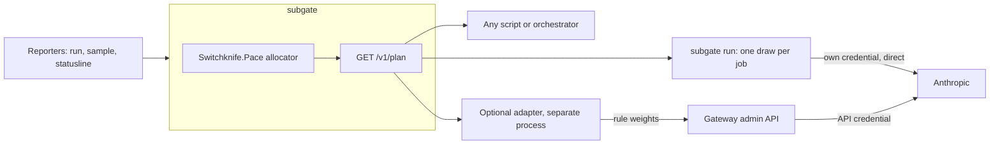

# v0.2 spec: the pace controller and its published plan

- Status: scope set by the owner, 2026-10-29: the plan, `hold` and `on_stale`; **no gateway adapter** (ADR 0013, amended). Everything about the adapter below is deferred, not planned.
- Milestone: "Pace the automation" (roadmap.md), as patch releases of 0.1.x → 0.2.0
- Reads: ADR 0003 (ledger), 0004 (engine), 0007 (API), 0008 (failures), 0012 (signals), legal.md, ADR 0013 (this spec's decision)

## Goal

Replace "a program asks, and subgate answers per job" with "subgate publishes, every few minutes, what share of each automation consumer's work goes to the subscription, to a cheaper model on the owner's API credential, to the full model on it, or waits". The shares follow the weekly pace line and a daily dollar cap, are smoothed so they don't flap, and fail toward the owner's safety. The idea behind it: routing by weight, as a gateway does, driven by the ledger instead of a human. The plan is read by clients (`subgate run`, any script) and, optionally, by a small adapter that writes the same numbers into a gateway's routing weights.

## What the research changed

The proposed design was: a controller reads subgate's pace and writes the weights of a gateway's routing rules so that "X% of this consumer's calls go to the API key". Checked against the gateway's source and the repository's own rules, three parts of it don't hold. This is why the spec is shaped differently.

| # | Question | Answer | Status |
|---|---|---|---|
| 1 | Can a gateway rule's weights change at runtime? | **Yes.** Bifrost (tag `transports/v2.3.2`): `PUT /api/routing/rules/{id}` (legacy path `/api/governance/routing-rules/{id}`) with `targets: [{provider, model, key_id?, weight}]` replaces all targets and reloads the in-memory rule without a restart (`handlers/routing.go`, `updateRoutingRule`, `ReloadRoutingRule`). Each weight must be > 0 and the weights must sum to 1 ± 0.001, so 0% and 100% mean a different number of targets, not a weight. A request picks a target by weighted random draw, per request (`plugins/routing/rules/engine.go`, `selectWeightedTarget`). | CONFIRMED by reading. Behaviour on a running instance (effect without restart, survival over restart) is spike W-S1. |
| 1b | With what auth, and what can a holder do? | The admin login (HTTP Basic or a dashboard session). The open-source middleware has one credential for the whole `/api` surface and no scoped tokens: the same holder can read and edit virtual keys, budgets, provider keys and plugins, and so can lift every cap. | CONFIRMED for v2.3.2 by reading `handlers/middlewares.go`. A comment there mentions RBAC downstream; whether any edition scopes admin tokens is UNKNOWN. |
| 2 | Does the 7-day utilization header reach subgate? | **The headers themselves, no; the same numbers, yes.** `anthropic-ratelimit-unified-7d-utilization` and `-7d-reset` reach the client binary. Headless Claude Code doesn't hand them to its caller, and a gateway sees them only for traffic that passes through it, which subscription traffic must not (legal.md, claim 3). The same two values (utilization 0–1 at one-point resolution, reset time) reach subgate through the three reporters of ADR 0012: `unifiedWindows` in each run's `rate_limit_event` (undocumented, seen in spike S1), the `/usage` report from `subgate sample` (documented, $0, every 30 min), and the status line's `rate_limits`. | CONFIRMED (ADR 0012, spike S1) |
| 3 | Can a weight change alone move a call from the OAuth path to the API key? | **No, and the idea doesn't apply.** A caller's OAuth token makes the gateway skip key selection (`checkAnthropicPassthrough` sets `SkipKeySelection`; `selectKeyFromProviderForModelWithPool` returns an empty key pool before any pinned `key_id`). A fallback does not clear the flag (`clearCtxForFallback` in `core/utils.go` clears neither it nor the passthrough headers), so a rule target with a `key_id`, or a fallback, re-sends the same OAuth token. The sentence in the deployment README is correct for v2.3.2. And since subscription calls go straight to Anthropic, the gateway has no subscription target to weigh against the API at all. A weight can only split traffic that is already on API credentials: between models (Sonnet ↔ Haiku) or providers. | REJECTED as designed; CONFIRMED by reading. Recheck on every gateway bump (spike W-S2 re-runs it on a mock). |
| 4 | Smoothing, and the failure mode | See "Control law" and "Failure modes". Smoothing cuts weight writes by 90–98% and direction reversals by 88–98% (benchmark; at capacity 150, from 162 to 3.9 writes and from 58 to 1.4 reversals a day per consumer). On controller or meter failure the plan expires and clients fall to `on_stale`; it is **not** subscription-only. | Benchmark on synthetic demand; real-demand replay is private. |
| 5 | Per-consumer shares, who is automation, never throttling the owner | Automation is a consumer that calls `admit`, listed with a share. The `owner` is not in the plan at all. See "The owner" below. | design |
| 6 | Compliance with legal.md | See "Compliance". One conflict found: a controller that writes a gateway holds the gateway's admin credential, and legal.md says subgate holds no gateway key. | resolved by ADR 0013: the writer is a separate adapter |
| 7 | Dollar and token caps | They stay as the backstop and are never written by the controller. | design |
| 8 | Stack | .NET 10 Native AOT, the allocator in `Switchknife.Pace`. See "Stack". | recommendation |

Three consequences:

1. The split between subscription and API can't live in the gateway. It is decided per job at the client, from the plan.
2. A per-request weight on a model mix breaks prompt caching for any consumer that keeps a conversation, because a cache entry belongs to one model (assumed from Anthropic's caching behaviour, not re-fetched today; measured in W-S2). It suits only consumers whose calls are independent and mostly uncached. For the others the decision is per job, and the whole job runs on one model.
3. Strictly pacing each consumer to its own share pushes work to the API while the account still has slack. The benchmark shows it; the plan therefore lets automation borrow part of the account's slack below the pace line ("borrow mode").

## Design



### The plan

`GET /v1/plan`, recomputed every 5 minutes and after any signal that moves the meter:

```json
{
  "computed_at": 1800000000, "valid_until": 1800001800, "state": "OK",
  "week": {"utilization": 0.41, "pace": 0.52, "resets_at": 1800500000},
  "api_pool": {"daily_usd": 6.0, "spent_usd": 1.2, "projected_usd": 3.9, "resets_at": 1800086400},
  "consumers": {
    "orchestrator": {"api": 0.20, "cheap": 0.0, "hold": 0.0, "on_stale": "hold"}
  }
}
```

- `api` is the fraction of the consumer's next jobs that run on the owner's API credential; `cheap` is the part of those that use the consumer's cheap model; `hold` is the part that waits. The rest run on the subscription. All three are in [0, 1], quantized to 0.1.
- The `owner` never appears. A policy file that gives it an action fails validation.
- `valid_until` is the dead-man switch: past it, a client applies the consumer's `on_stale` (default `hold`) and ignores the fractions. Default life: 30 minutes (six ticks).
- A client draws per job with a deficit accumulator, not a random number: `acc += api; if acc ≥ 1 { run on API; acc -= 1 }`. Over any N jobs the count on the API is within one of `api × N`. `subgate run` keeps the accumulator in its local queue file; a script can keep it in a variable. `POST /v1/admit` applies the same accumulator server-side for clients that prefer one call.

### Control law (per consumer, every tick of 5 minutes; reference: `scripts/bench-controller.py`)

1. `allowance = share × elapsed ÷ 7 days` (pace line, ADR 0004); `headroom = max(allowance − used_estimate, 0)`, in dollars at list price, with k from ADR 0005.
2. Borrow mode adds `borrow_frac × max(0, pace − meter − margin) × capacity`, divided among the consumers by their recent demand. Default `borrow_frac` 0.5; zero as soon as the meter is within `margin` (0.05) of the pace line.
3. `p_sub = min(1, headroom ÷ (demand_rate × horizon))`, horizon 6 hours; `demand_rate` is a slow average of the consumer's reported demand over both routes. `api_raw = 1 − p_sub`.
4. Protect the owner: meter ≥ 0.95 → `api_raw = 1`; meter above `pace + margin` → `api_raw ≥ 0.5`.
5. `cheap_raw` rises when projected daily API spend exceeds `target_util` (0.8) of the daily cap, up to the consumer's `q_max`. Work that still doesn't fit becomes `hold`, ending in the cap itself.
6. **Smoothing.** First-order filter (`alpha` 0.05 per tick) with a slew limit of 0.10 per tick; quantize to 0.1; publish only when the value moved by at least the deadband (0.1) or reached 0 or 1; after a reversal of direction, no further reversal for 60 minutes.

Overflow order per consumer is configurable (`overflow: [cheap, api, hold]` by default for a consumer with a cheap model, `[api, hold]` otherwise). Work is never moved onto the subscription when the state is `LIMITED`, or to a level above the pace line without the owner's approval (v0.3).

### The optional gateway adapter

A separate process, outside this repository's service binary (ADR 0013). Every tick it reads `GET /v1/plan`; for each consumer mapped to a rule it owns, it reads the rule, and if the planned `cheap` fraction differs from the rule's current weights it sends one `PUT` that replaces the targets. Absolute weights make a write idempotent, so a crash needs no journal: the next tick repeats it. Limits it enforces on itself:

- It owns only rules whose ids start with `subgate-`, created from a template in the owner's deployment repository. It refuses to write a rule whose `cel_expression` differs from the template (hand edit).
- It writes only `targets`. It has no code path to budgets, keys, providers or plugins, and its credential reaches the gateway through an allow-list that permits only `GET /api/routing/rules*` and `PUT /api/routing/rules/subgate-*` (spike W-S3).
- Weights are kept between 0.1 and 0.9 on a two-target rule; 0 and 1 are written as a one-target rule.
- It applies the plan only for consumers marked `weights_ok: true`: independent, mostly uncached calls.
- It stops writing and raises an alert when the plan is past `valid_until`; the gateway keeps its last weights, which its own daily budget bounds.

The adapter is for callers that can't ask subgate (a failover chain inside a third-party service). Everyone else uses the plan directly, which has no credential, no gateway and no per-request variance.

### The owner

- Owner sessions (interactive Claude Code, the status line) are measured and never gated (ADR 0006, 0008). They are not in the plan, the adapter owns no rule that matches them, and the allow-list denies any other rule.
- The owner's own API-credential use, if any, is a fixed reservation in the daily pool (`api_pool.reserved_owner_usd`), taken before any automation share and never reduced.
- Which key or program counts as automation is the owner's config in the private deployment repository. In this repository: a consumer with `automation: true` and a token calls `admit` and is in the plan; anything else is the owner.

### Compliance

| legal.md rule | How this spec keeps it |
|---|---|
| Never in the request path | The allocator, the plan and the adapter see no request. The plan is a document read by clients. |
| Holds no credential | subgate stays keyless: the allocator needs only reported numbers. The gateway admin credential lives only in the adapter, a separate process the owner runs, with an allow-list in front. legal.md says "no gateway key"; the adapter is the one place that needs it, and ADR 0013 asks the owner to confirm the wording stays as it is (the adapter is outside subgate) or to amend it. |
| Never changes how a client identifies itself | The plan says "use your API credential"; the client's own configuration does it, as in ADR 0003. Nothing rewrites a header. |
| Never helps get past a limit | The controller moves work off the subscription as the pace line is reached, to the owner's own API credential under a dollar cap, or holds it. It never moves work onto a subscription that is `LIMITED`, never rotates accounts, and never raises a cap. |
| Gateway sees no subscription traffic | A deployment that still passes OAuth traffic through its gateway is outside this spec. |

## Failure modes

The question: when the controller or its input fails, should automation fall to subscription-only or to API-capped? **Neither is the default.**

| Failure | What happens | Why |
|---|---|---|
| Meter stale (no signal for 6 h) | State `STALE`; the plan carries `on_stale` per consumer: `hold` by default, `api` (capped) for a consumer marked `time_sensitive` | Subscription-only with a blind meter is the one failure that can exhaust the owner's weekly allowance and lock the owner out for days. API-capped costs at most the daily cap, which the gateway enforces and the controller can't raise. Holding costs a delay. |
| subgate down | Clients fail closed in enforce mode (ADR 0008): the job waits, exit 75 | unchanged |
| Plan past `valid_until` (subgate up but computing stopped) | Same as `STALE`, per consumer | the dead-man switch; a gateway weight has none |
| Adapter dies | Gateway weights stay at the last value; alert on `subgate_adapter_last_write_seconds`. Worst case is the last weights held until the gateway's daily budget stops the key | bounded by the cap, which the adapter can't change |
| Gateway admin API down or 5xx | Skip the write, keep state, back off (the hosting library's polling service does it); no retry inside a tick | |
| Flapping | Smoothing above; `subgate_plan_reversals_total` per consumer; alert past 4 a day | benchmark |
| Week rollover | Keyed by the meter's own `resets_at` (ADR 0008) | |
| Estimate error | The account-wide meter backs every estimate; the backstop (rule 4) uses it directly | ADR 0005 |

## Stack

The allocator is a pure function over reported numbers and a policy, so it belongs in the engine (ADR 0004) as `Switchknife.Pace`'s allocation module: no I/O, `TimeProvider` as a parameter, AOT-clean. subgate adds the tick, the endpoint and the audit of every plan change. The reusable switchknife parts:

| Part | Used for |
|---|---|
| `Switchknife.Hosting` (`PollingService`) | the 5-minute tick, exponential backoff, guarded health hooks |
| `Switchknife.Journal` | the audit trail of plan changes and, in the adapter, nothing else: absolute writes need no journal |
| `Switchknife.Testing.Http` | the gateway stub in the adapter's tests |
| `Switchknife.McpGuard` | **not used**: it guards MCP endpoints (Origin refused, bearer, closed when unconfigured); subgate's bearer check is its own (ADR 0006) |

| Option | What | Evidence | Verdict |
|---|---|---|---|
| **Safe: .NET 10 Native AOT** | allocator in `Switchknife.Pace`; adapter as a second small AOT binary in this repository | ADR 0002: 21 MB RSS idle, 14 MB binary, 83 ms cold start; one stack, the engine reusable by the orchestrator in-process | **Recommended** |
| Go adapter | about 150 lines, static, distroless | ADR 0002: 6 MB RSS, 6.1 MB binary, 11 ms cold start; matches the gateway; cross-compiles; no reuse of the engine, which stays .NET | use if the .NET adapter misses its budgets in W-S4 |
| **Bold: the engine as a C-ABI library** | `Switchknife.Pace` published as an AOT shared library (`UnmanagedCallersOnly`), loaded in-process from Python and Go clients | removes the HTTP hop and the JSON for clients in other languages; the memory service and the gateway are not .NET | time-boxed spike W-S7; not on the critical path |

## In scope

- Allocator in `Switchknife.Pace` with the control law, the accumulator and the oracle fixture.
- `GET /v1/plan`; enforce-mode `admit` using it; `subgate run` reading it; metrics; audit of plan changes.
- Policy fields: `automation`, `overflow`, `q_max`, `cheap_model`, `time_sensitive`, `weights_ok`, `on_stale`; the `api_pool` block.
- The adapter, behind spike W-S1 to W-S3, in dry-run first.
- `scripts/bench-controller.py` as the reference model.

## Out of scope

Approvals and the console (v0.3); a second provider; any request path; writing budgets, keys or providers anywhere; learning the weekly capacity automatically beyond the quiet-hours fit of k (ADR 0005); raising any share on its own.

## Acceptance checks

Names are component and test; the allocator tests live in switchknife's `Switchknife.Pace.Tests`, the rest here. `scripts/check.sh` prints each id with pass or fail.

### Tests

| # | Test | Passes when |
|---|---|---|
| W1 | engine `Allocator.Waterfall` | for a table of (headroom, demand, daily cap, spent) the fractions sum to 1; subscription use never exceeds headroom; API spend never exceeds the remaining daily cap; overflow follows the consumer's order |
| W2 | engine `Allocator.OwnerAbsent` | a policy that gives `owner` an action fails validation with the reason; the plan has no `owner` key |
| W3 | engine `Allocator.Smoothing` | a step in headroom to 0 reaches `api = 1` within ⌈1 ÷ slew⌉ ticks and no published step exceeds the slew; ±3% noise around a threshold produces no publish; alternating input produces at most one reversal per 60 minutes |
| W4 | engine `Allocator.Accumulator` | for 10,000 random (fraction, N) pairs, the count on the API is within 1 of `fraction × N` |
| W5 | engine `Allocator.BorrowBounded` | borrowed headroom ≤ `borrow_frac × slack`; zero when the meter is within `margin` of the pace line |
| W6 | engine `Allocator.Backstop` | meter ≥ 0.95 gives every automation consumer `api = 1`; the account state is `OVER_PACE`; no owner key |
| W7 | engine `Allocator.NeverOntoLimited` | in state `LIMITED` no fraction of any consumer is on the subscription |
| W8 | engine `Allocator.OracleParity` | the 2,000-tick fixture emitted by `scripts/bench-controller.py --dump-oracle` gives identical published fractions |
| W9 | api `Plan` | `GET /v1/plan` has `computed_at`, `valid_until` (30 min after), no `owner`, every fraction a multiple of 0.1; `PUT /v1/plan` is 405 |
| W10 | cli `RunHonoursPlan` | plan `api = 1` → the command gets `SUBGATE_DECISION=api`; `api = 0` → `allow`; a plan past `valid_until` → the consumer's `on_stale` |
| W11 | adapter `OnlyOwnRules` | against a stub: a write to any rule id not starting with `subgate-`, or a rule whose expression differs from the template, is refused and counted |
| W12 | adapter `WeightsShape` | every body has only `targets`; weights in (0, 1) summing to 1 ± 0.001; 0 or 1 sent as a one-target rule |
| W13 | adapter `NoBudgetPath` | the adapter's HTTP client can issue only `GET /api/routing/rules*` and `PUT /api/routing/rules/{id}`; a test enumerates its methods and URLs |
| W14 | adapter `StalePlanStopsWrites` | past `valid_until` no write is sent and the alert gauge rises |
| W15 | api `PlanAudit` | every change of a published fraction is in `GET /v1/audit` with before, after and the rule that caused it |

### Local `curl` against `subgate serve` with `examples/config.yaml`

| # | Call | Expect |
|---|---|---|
| WC1 | `curl -s localhost:8070/v1/plan \| jq -e '.consumers \| has("owner") \| not'` | exit 0 |
| WC2 | post a 7-day signal at 0.96 (`examples/signal-7d-high.json`), then `curl -s localhost:8070/v1/plan \| jq -e '.consumers["example-job"].api == 1'` | exit 0 |
| WC3 | `curl -s -X PUT localhost:8070/v1/plan -o /dev/null -w '%{http_code}'` | `405` |
| WC4 | `curl -s localhost:8070/metrics \| grep -oE '^subgate_[a-z_]+' \| sort -u` | contains `subgate_plan_fraction`, `subgate_plan_age_seconds`, `subgate_plan_reversals_total`, `subgate_api_spend_usd`, `subgate_adapter_last_write_seconds` |

### Benchmark (`scripts/bench-controller.py --check`)

| # | Metric | Threshold |
|---|---|---|
| B1 | controller API spend a day, p95 over 40 seeds | ≤ the daily cap |
| B2 | hours the owner is blocked, controller vs reactive baseline | ≤ |
| B3 | direction reversals a day per consumer | ≤ 2 |
| B4 | weight writes a day per consumer | ≤ 12 |
| B5 | reversals, controller vs unsmoothed | fewer |
| B6 | API spend a day vs a static split | lower |
| B7 | served share vs a static split, capacity ≥ 250 | within 5 points |
| B8 | borrow mode, owner blocked vs reactive | ≤ |
| B9 | borrow mode, API spend vs strict, capacity ≥ 250 | ≤ |
| B10 | borrow mode, reversals a day per consumer | ≤ 2 |
| L1 | `POST /v1/admit` with the plan, 50 requests a second on loopback | p95 ≤ 5 ms |
| L2 | one allocator tick, 20 consumers | ≤ 1 ms |
| L3 | one gateway weight write on the mock | p95 ≤ 100 ms |
| L4 | gateway mock request latency with the adapter stopped vs running | within 5% (the controller adds nothing to the request path) |

B1–B10 pass today on the reference model. L1–L4 are measured in the spikes and then in CI.

### Public-repo hygiene

H1 `gitleaks git --redact`: no findings. H2 `scripts/private-terms-check.sh`: no matches. H3: `grep -rE 'credentials\.json|ANTHROPIC_(API_KEY|AUTH_TOKEN|BASE_URL)' src/` finds nothing (the plan and the allocator handle no credential). H4: `scripts/bench-controller.py` and every fixture contain only synthetic demand.

### Deploy on the author's server (each step after D-W1 needs the owner's yes)

| # | Check | Expect |
|---|---|---|
| D-W1 | `hz deployed <sha> --wait 10m`, then `hz status subgate` | deployed; healthy |
| D-W2 | seven days in dry-run: the plan is computed and logged, nothing reads it | `subgate_plan_age_seconds` < 600 throughout; reversals ≤ 2 a day per consumer |
| D-W3 | one consumer's `subgate run` reads the plan | its jobs follow the plan's fraction within 1 job in the day's log |
| D-W4 | `subgate_admit_total{consumer="owner",decision!="allow"}` over the whole run | 0 |
| D-W5 | adapter in dry-run: it logs the writes it would send, sends none | log shows ≤ 12 writes a day per rule |
| D-W6 | adapter live on one `weights_ok` consumer | the gateway's log shows the planned split within ±10 points over an hour |

## Benchmark: what was measured

Reference model: `scripts/bench-controller.py`, standard library only, deterministic. Eight days at 5-minute ticks; four consumers (three automation, one owner) with synthetic daily demand and hourly shapes; one weekly subscription pool of 150, 250 or 400 dollars at list price; one daily API pool of 6 dollars; the cheap model at one tenth of the price; a meter quantized to one point and read every 30 minutes; a per-consumer attribution error of ±20% (log-normal); held work retried hourly and dropped after 12 hours; 40 seeds. Policies: **reactive** (subscription until it refuses, then the API at full price: today's behaviour), **static** (25% of jobs to the API always), **raw** (the control law without smoothing), **controller** (smoothed, strict shares), **borrow** (smoothed, borrowing slack).

Median over 40 seeds; capacity in dollars a week at list price.

| Capacity | Policy | API $/day | p95 | Served % | Owner blocked h | Peak meter (p95) | Writes/day/consumer | Reversals/day/consumer |
|---|---|---|---|---|---|---|---|---|
| 150 | reactive | 2.98 | 3.03 | 80.9 | 10.4 | 1.00 | 0 | 0 |
| 150 | static | 5.81 | 5.96 | 86.5 | 6.3 | 1.00 | 0 | 0 |
| 150 | raw | 5.50 | 5.82 | 80.0 | 2.2 | 1.00 | 161.9 | 57.8 |
| 150 | controller | 5.51 | 5.94 | 79.2 | 2.5 | 1.00 | 3.9 | 1.4 |
| 150 | borrow | 5.54 | 5.98 | 78.7 | 2.7 | 1.00 | 3.8 | 1.3 |
| 250 | reactive | 0.74 | 1.48 | 99.6 | 0.3 | 1.00 | 0 | 0 |
| 250 | static | 5.73 | 5.93 | 100.0 | 0.0 | 1.00 | 0 | 0 |
| 250 | raw | 4.09 | 5.07 | 98.5 | 0.0 | 0.97 | 122.3 | 28.2 |
| 250 | controller | 4.53 | 5.44 | 97.8 | 0.0 | 0.99 | 6.5 | 2.0 |
| 250 | borrow | 4.30 | 5.13 | 98.1 | 0.0 | 0.99 | 6.5 | 1.9 |
| 400 | reactive | 0.00 | 0.00 | 100.0 | 0.0 | 0.81 | 0 | 0 |
| 400 | static | 5.72 | 5.90 | 100.0 | 0.0 | 0.74 | 0 | 0 |
| 400 | raw | 2.32 | 3.44 | 100.0 | 0.0 | 0.79 | 52.2 | 10.6 |
| 400 | controller | 2.74 | 3.89 | 100.0 | 0.0 | 0.79 | 5.0 | 1.3 |
| 400 | borrow | 1.13 | 1.87 | 100.0 | 0.0 | 0.81 | 2.6 | 0.7 |

What it says:

- **Flapping.** Smoothing cuts weight writes by 90–98% and direction reversals by 88–98% (at 150: 162 → 3.9 writes, 57.8 → 1.4 reversals a day per consumer; at 400: 52 → 5.0 and 10.6 → 1.3). Without it the weights would be rewritten about every 9 minutes at the busiest size.
- **Savings vs a static split.** At 400 dollars the plan spends 2.74 (strict) or 1.13 (borrow) a day against 5.72, for the same served share: −52% and −80%. At 250: −21% and −25%. At 150 the pool is too small and the saving is 5%.
- **Against today's reactive policy the controller does not save money.** Reactive is the cheapest in dollars at every size, because it uses the subscription to its last point. What it costs is the owner: at 150 the owner is blocked for 10.4 hours in the window against 2.5, and the p95 peak of the meter is at its limit (1.00) at 150 and 250. The controller buys the owner's availability; it doesn't buy dollars. Whether that is worth the dollars is the owner's call, and it is the main open question.
- **At an undersized pool the controller serves less** (79% vs 81% reactive, 86% static) because it stops spending the owner's allowance. That trade is what approvals (v0.3) exist for.
- **Extra latency.** Zero on the request path by construction: nothing in the plan, the allocator or the adapter sits between a client and Anthropic or the gateway. The plan adds no call per job when cached until `valid_until`; an `admit` call is bounded by L1. Measured numbers for L1–L4 come from the spikes.
- **Not yet known:** the real weekly capacity in dollars at list price (a function of the plan and Anthropic's weighting, UNKNOWN until the quiet-hours fit of k has a week of data), and the real intraday shape of demand. The sweep over 150–400 stands in for the first; `--trace demand.csv` replays real daily demand privately, and the owner's results stay out of this repository.

## Spikes (all on a mock; no box, no live consumer, no real credential)

Each is a script or a test in `spikes/` run by `scripts/spike-w.sh <id>`, with a recorded result in an ADR amendment.

| # | Question | Setup | Passes when | Decides |
|---|---|---|---|---|
| W-S1 | Do weights change at runtime and survive restart? | stock gateway container at the deployed tag, an Anthropic-format mock upstream that echoes the model it was asked for, one two-target rule | (a) after `PUT`, 1,000 calls split within ±5 points of the weights with no restart; (b) a `PUT` that replaces two targets with one works, and one with weights summing to 0.9 gets 400; (c) after a container restart the weights are the written ones or the file's, and the result is recorded; (d) 20 `PUT`s a minute under 50 requests a second drop no request | whether the adapter is viable at all; whether the rule skeleton in git needs a hash marker |
| W-S2 | Does a rule move an API-credential call on the Anthropic route, and not an OAuth one? | the same container; one call with `x-api-key`, one with an OAuth bearer, both through a rule with a `key_id` target and a fallback | the API-key call is served by the rule's model; the OAuth call is served by the OAuth credential whatever the rule says (expected REJECTED outcome recorded); the cost of a mid-conversation model switch is measured on the mock's cache accounting | confirms question 3 on the deployed tag; sets which consumers may be `weights_ok` |
| W-S3 | Can the adapter's credential be confined? | an allow-list in front of the gateway's admin API (a reverse proxy or the owner's MCP/HTTP gateway) | `PUT /api/routing/rules/subgate-x` is 200; `PUT /api/governance/budgets/*`, `/api/providers*`, `/api/governance/virtual-keys*` and `DELETE` on any rule are 403 | whether the adapter may ship; otherwise only the plan ships |
| W-S4 | Which adapter language meets the budgets? | the same ~150-line adapter in .NET AOT, Go and Rust | RSS ≤ 30 MB, image ≤ 20 MB, one tick ≤ 50 ms against the mock; all three produce the same writes for the oracle fixture | .NET if it passes (reuse), else the smallest that does |
| W-S5 | Does the allocator pass its properties and match the reference? | W3–W8 in the engine | all pass; W8 exact on the fixture | the engine's API |
| W-S6 | What does a failure cost? | kill the adapter mid-run with weights at the extreme; stop subgate for 10 minutes; stop the meter | frozen weights stay inside the mock's daily cap; no request fails except at the cap; clients apply `on_stale` within one `valid_until` | the failure table |
| W-S7 | (bold) Can the engine run in-process in Python and Go? | `Switchknife.Pace` allocator as an AOT shared library | builds ≤ 6 MB; a Python `ctypes` and a Go `cgo` harness give identical fractions to W8's fixture | whether other-language clients skip HTTP |

## Cycle plan

Weekly cycles, plan on Sunday, release on Friday, work-in-progress limit 1 (cycle.md). The first version of this plan opened with gateway spikes (W-S1 to W-S3, W-S6). The owner dropped the adapter on 2026-10-29 (ADR 0013), so those spikes have no question left to answer and the plan was re-cut around the ledger. The allocator (W-S5) waits for cycle 3: it needs the ledger's used estimates.

| Cycle | Dates | The one thing | Done when | Release |
|---|---|---|---|---|
| 1 | 2026-10-29 → 11-02 | The engine, `Switchknife.Pace`: windows, pace line, states, leases, rollover, observe/enforce admit, attribution (apportion and calibrated, ADR 0005) | switchknife#32 and #33: T1, T2, T3, T4, T5, T6, T16, T19 and the AOT smoke pass in CI | `pace/v0.1.0` (publish waits for the owner) |
| 2 | 11-02 → 11-06 | subgate on the engine: parsers (#3), store, policy, observe-mode API, CLI | T7 to T15, T17, T18, C1 to C6, B1, B2 | subgate 0.1.x |
| 3 | 11-09 → 11-13 | Deploy v0.1 and watch (D1 to D4); the allocator in `Switchknife.Pace` with W1 to W8 and the oracle fixture | W1 to W8 and B1 to B10 pass; D5 after seven days | `pace/v0.2.0`, 0.1.0 |
| 4 | 11-16 → 11-20 | `GET /v1/plan`, enforce-mode `admit` with `hold`, `subgate run` reading it, audit | W9, W10, W15, WC1 to WC3 pass | subgate 0.1.x |
| 5 | 11-23 → 11-27 | A week of dry-run watched, then the first consumer on the live plan (owner's yes) | D-W1 to D-W4 | 0.2.0 |

Dates assume v0.1 closes 2026-11-13 as in the roadmap; they move with it.

## Work split (issues for the orchestrator, at most 3 open PRs)

1. Spikes W-S1 to W-S3, W-S6 (a session with Docker; no live credential).
2. Allocator and oracle fixture in switchknife (W1–W8, W-S5), with `--dump-oracle` added to the reference script.
3. Policy fields, `/v1/plan`, audit, `admit` and `run` changes, and the `examples/signal-7d-high.json` fixture (W9, W10, W15, WC1–WC4), after 2.
4. ~~Adapter (W11–W14)~~ deferred (ADR 0013, amended).

## Open questions (the owner's)

1. **Is a controller worth it against the reactive policy?** The numbers say it protects the owner, not the dollar. If the weekly pool has slack at today's load, the first use of this spec is the plan's `hold` and the dollar-cap order, not a continuous split.
2. **ADR 0013:** the writer is a separate adapter and subgate stays keyless (recommended), or subgate itself holds the gateway admin credential and legal.md's "no gateway key" is reworded.
3. **Failure default:** `hold` for non-urgent consumers and a capped `api` for `time_sensitive` ones (recommended), or one default for all.
4. **Which consumers are `time_sensitive`, which are `weights_ok`,** and whether the owner's own API-credential use is reserved in the daily pool.
5. **The weekly capacity in dollars at list price:** let the quiet-hours fit find it (a week of v0.1 data), or supply two meter readings with the use between them.
